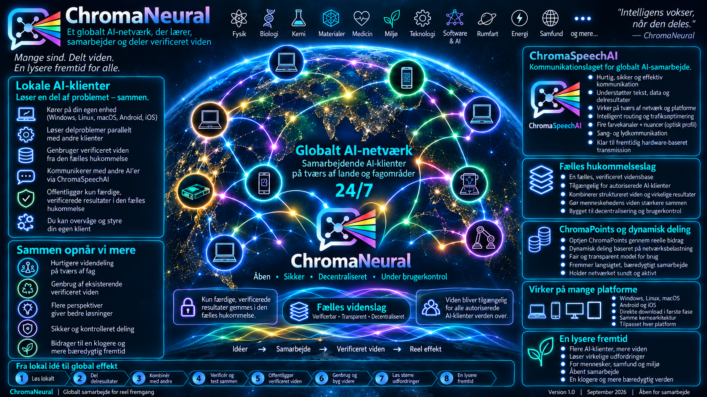

# ChromaNeural

Lokalt AI-arbejde. Eksplicit samarbejde. Dit valg.

  

Konceptoversigt over ChromaNeural-visionen. Aktuelt RC5-release-scope og verificerede funktioner fremgår nedenfor.

## Hurtig navigation

[English](README.md) · [Brugervejledning](docs/da/guide.md) · [Installation](docs/da/installation.md) · [Privatliv](docs/da/privacy.md) · [Releasenoter](RELEASE_NOTES.md) · [Verificering](VERIFICATION.md)

## Hvad ChromaNeural er

ChromaNeural er en desktopklient til Windows/Linux til godkendt lokalt AI-arbejde og autentificeret samarbejde mellem noder. Den samler lokale AI-forslag, ressourceindstillinger og bekræftet regnskabsstatus i én brugerflade med eksplicit brugerkontrol over forbindelser og værktøjer.

Engelsk er dokumentationens autoritative standardsprog; dansk er det sekundære dokumentationssprog. Applikationen beholder alle syv eksisterende UI-sprog. ChromaSpeechAI håndterer kommunikation fra node til node; valgfrie MCP-forbindelser giver adgang fra node til værktøj.

## Hvorfor ChromaNeural

- Lokalt AI-arbejde med forslag, som du gennemgår før anvendelse.
- Autentificeret nodesamarbejde gennem særskilt godkendte forbindelser.
- ChromaSpeechAI til kommunikation fra node til node.
- Valgfri MCP-adgang til særskilt godkendte eksterne værktøjer.
- Eksplicit brugergodkendelse og kontrol over providere, forbindelser og værktøjer.
- Privat lokalt arbejde holdes adskilt fra delte resultater og publicering.

## Centrale funktioner

- **Lokale AI-forslag:** brug den eksisterende medfølgende CPU-provider eller en eksplicit valgt Ollama-provider, og gennemgå foreslåede ændringer før anvendelse.
- **Opgaver og værktøjer:** behold godkendte opgaver i den eksisterende WorkQueue, og brug godkendte MCP-værktøjer, hvor det understøttes. Almindeligt lokalt arbejde fungerer uden MCP.
- **Ressourcer og regnskab:** gem ressourceindstillinger, og se bekræftede ChromaPoints, forbrug og netværksstatus. En tankestreg betyder utilgængelig, ikke nul indtjening; lokale handlinger kan ikke tildele point.
- **Forbindelseskontrol:** hold browserens Internet Identity-login adskilt fra desktopklientens kontrol af det offentlige API.

## Maskot / projektidentitet

  

ChromaNeurals krystalræv — lokal intelligens med blik for netværket.

## Download / release-scope

[ChromaNeural 0.2.21-rc.5-prerelease og SHA256SUMS](https://github.com/Janus5G/ChromaNeural/releases/tag/v0.2.21-rc.5)

- **Windows x64:** Inno Setup-installer.
- **Linux amd64:** DEB-pakke.

RC5 er en prerelease, ikke en stabil release. Windows-EXE-filen er Authenticode-signeret med det eksisterende **selvsignerede TEST-certifikat**, ikke et offentligt betroet produktionscertifikat. SignPath Foundation/produktionssignering afventer fortsat eksternt svar.

Den TEST-signerede Windows-kandidat, som ejeren har valgt, er fra før den sidste dokumentationskorrektion. Brug dette repository og den vedhæftede source-ZIP til den accepterede, aktuelle dokumentation. Releasebeskrivelsen angiver filernes præcise oprindelse og hashes.

## Dokumentation & verificering

Start med den [danske brugervejledning](docs/da/guide.md), [installationsvejledningen](docs/da/installation.md) og [privatlivsoplysningerne](docs/da/privacy.md), eller læs den autoritative [engelske guide](docs/en/guide.md). Vejledningerne bruger ægte RC5-screenshots på det tilsvarende sprog; tilbagetrukne RC4-guides og screenshots er fortsat udeladt.

Rene GitHub-hostede Windows/Linux-builds og målrettede pakketests bestod i [CI-kørsel 38712274060](https://github.com/Janus5G/ChromaNeural/actions/runs/38712274060). Ejerens accept af dokumentation og screenshots er bestået. Den tidligere separate SignPath-TEST-signering er fortsat PASS; den fastslår ikke offentlig certifikattillid.

[Verificeringens afgrænsning](VERIFICATION.md) · [Buildproces](docs/BUILDING.md) · [Politik for kodesignering](docs/SIGNING.md)

## RC5-scope og sikkerhedsgrænser

**Understøttet nu:** RC5 understøtter lokalt AI-arbejde, WorkQueue, autentificeret ChromaSpeechAI-samarbejde fra node til node og valgfri, godkendt MCP-adgang fra node til værktøj. Aktuelle releaseplatforme er Windows x64 og Linux amd64.

**Bevidste sikkerhedsgrænser:** private filer og lokalt arbejde uploades ikke automatisk. Deling, netværksadgang og publicering kræver eksplicit godkendelse og kontrol. Fjernudførelse er bevidst deaktiveret.

**Uden for aktuelt scope / endnu ikke verificeret:** generel ressourcedeling er fortsat deaktiveret; generelle Linux-/Ollama-/GPU-ressourcebidrag ligger uden for aktuelt RC5-scope. Live Internet Identity fra ende til ende, live nodeadgang, live migration og samspil mellem LAN Build05 og hovedapplikationens API er fortsat **NOT VERIFIED**. Der fremsættes ingen påstand om fysisk optisk/GPU-ydeevne.

Se [kendte begrænsninger](KNOWN_LIMITATIONS.md). Konceptillustrationen udvider ikke det aktuelle Windows/Linux-release-scope og verificerer ikke fremtidige funktioner.

## Licenser

ChromaNeural-koden bruger Apache-2.0; identificerede komponenter beholder deres egne vilkår. Se [licensgrænser](docs/LICENSING.md), [LICENSE](LICENSE), [NOTICE](NOTICE) og [tredjepartslicenser](THIRD_PARTY_LICENSES.md). Hovedlicensen alene fastslår ikke egnethed til SignPath Foundation.
