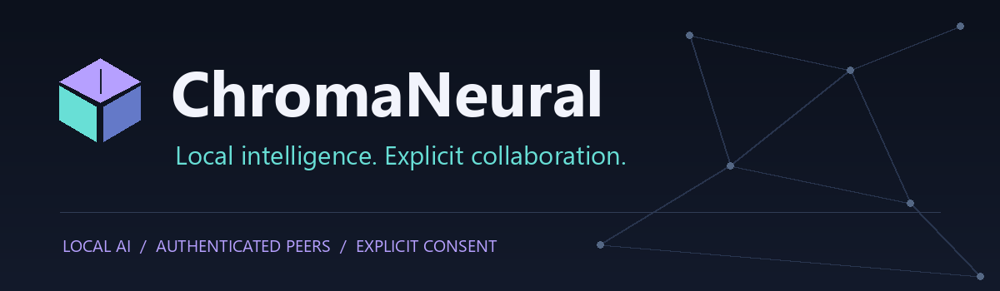

# ChromaNeural

Local AI work. Explicit collaboration. Your choice.

  

Concept overview of the ChromaNeural vision. Current RC6 release scope and verified capabilities are documented below.

## Quick navigation

[Dansk](README-DK.md) · [User guide](docs/en/guide.md) · [Installation](docs/en/installation.md) · [Privacy](docs/en/privacy.md) · [Release notes](RELEASE_NOTES.md) · [Verification](VERIFICATION.md)

## What ChromaNeural is

ChromaNeural is a Linux amd64 desktop client for approved local AI work and authenticated collaboration between nodes. It brings local AI proposals, resource preferences and confirmed accounting status into one interface, with explicit user control over connections and tools.

English is the canonical/default documentation language; Danish is the secondary documentation language. The application retains all seven existing UI languages. ChromaSpeechAI handles node-to-node communication; optional MCP connections provide node-to-tool access.

## Why ChromaNeural

- Local-first AI work with proposals you review before applying.
- Authenticated node collaboration through separately approved connections.
- ChromaSpeechAI for node-to-node communication.
- Optional MCP access to individually approved external tools.
- Explicit user approval and control over providers, connections and tools.
- Private local work kept separate from shared results and publication.

## Core capabilities

- **Local AI proposals:** use the existing bundled CPU provider or an explicitly selected Ollama provider, then review proposed changes before applying them.
- **Tasks and tools:** keep approved tasks in the existing WorkQueue; configure and approve optional MCP connections. Controlled MCP tool execution is disabled in this prerelease pending production accounting and measurement. Ordinary local work remains available without MCP. Guided setup includes a curated catalog; profiles are NOT VERIFIED or EXPERIMENTAL, not verified vendor support.
- **Resources and accounting:** save resource preferences and view confirmed ChromaPoints, usage and network status. A dash means unavailable, not zero earnings; local actions cannot award points.
- **Connection controls:** keep browser Internet Identity login separate from the desktop's public API connection check.

## Download / release scope

**Official release: Linux amd64.** Source code remains available for community ports and experimentation on other platforms. Windows, macOS and mobile platforms are not currently officially supported or verified.

[ChromaNeural 0.2.21-rc.6 prerelease](https://github.com/Janus5G/ChromaNeural/releases/tag/v0.2.21-rc.6) · [SHA256SUMS.txt](https://github.com/Janus5G/ChromaNeural/releases/download/v0.2.21-rc.6/SHA256SUMS.txt)

The Linux DEB and curated source ZIP are the release files. RC6 is a prerelease, not a stable release.

## Documentation & verification

Start with the [English user guide](docs/en/guide.md), [installation instructions](docs/en/installation.md) and [privacy information](docs/en/privacy.md), or read the complete [Danish guide](docs/da/guide.md). The guides use retained genuine language-matched RC5 screenshots; withdrawn RC4 guides and screenshots remain excluded.

Owner acceptance of documentation, screenshots and the guided AI/MCP setup is PASS. The active build uses a clean GitHub-hosted Linux checkout; see [verification](VERIFICATION.md) for scope and historical evidence.

[Verification boundaries](VERIFICATION.md) · [Build process](docs/BUILDING.md)

**Fair Use V2 production status: NOT TESTED — disabled.** Production accounting, production resource measurement and the numeric settlement GUI are not connected end-to-end. Local software tests and simulated GUI flows passed; they are not production acceptance. Controlled MCP tools remain paused; local AI continues after explicit selection. See [Resource Fair Use status](docs/en/mcp-usage.md).

## RC6 scope and safety boundaries

**Supported now:** RC6 supports local AI work, WorkQueue, authenticated ChromaSpeechAI node-to-node collaboration and optional MCP setup with explicit connection/tool approvals. The official release target is Linux amd64.

**Safety by design:** private files and local work are not uploaded automatically. Sharing, network admission and publication require explicit approval and control. Remote execution is deliberately disabled.

**Outside current scope / not yet verified:** general resource sharing remains disabled; general Linux/Ollama/GPU resource contribution is outside current RC6 scope. Live Internet Identity end-to-end, live node admission, live migration and LAN Build05 ↔ main API interoperability remain **NOT VERIFIED**. No physical optical/GPU performance claim is made.

See [known limitations](KNOWN_LIMITATIONS.md). The conceptual artwork does not expand the official Linux release scope or certify future capabilities.

## Licenses

ChromaNeural code uses Apache-2.0; identified components retain their own terms. Read [license boundaries](docs/LICENSING.md), [LICENSE](LICENSE), [NOTICE](NOTICE) and [third-party licenses](THIRD_PARTY_LICENSES.md).
