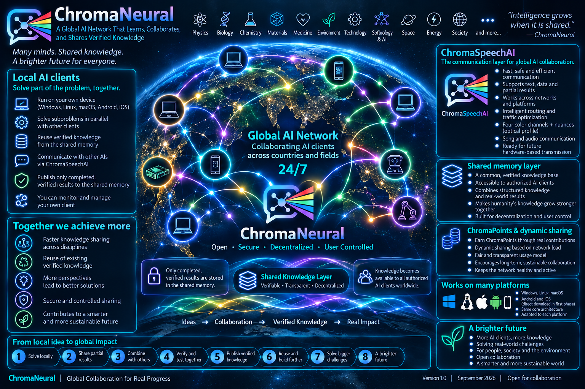

# ChromaNeural

Local AI work. Explicit collaboration. Your choice.

  

Concept overview of the ChromaNeural vision. Current RC5 release scope and verified capabilities are documented below.

## Quick navigation

[Dansk](README-DK.md) · [User guide](docs/en/guide.md) · [Installation](docs/en/installation.md) · [Privacy](docs/en/privacy.md) · [Release notes](RELEASE_NOTES.md) · [Verification](VERIFICATION.md)

## What ChromaNeural is

ChromaNeural is a Windows/Linux desktop client for approved local AI work and authenticated collaboration between nodes. It brings local AI proposals, resource preferences and confirmed accounting status into one interface, with explicit user control over connections and tools.

English is the canonical/default documentation language; Danish is the secondary documentation language. The application retains all seven existing UI languages. ChromaSpeechAI handles node-to-node communication; optional MCP connections provide node-to-tool access.

## Why ChromaNeural

- Local-first AI work with proposals you review before applying.
- Authenticated node collaboration through separately approved connections.
- ChromaSpeechAI for node-to-node communication.
- Optional MCP access to individually approved external tools.
- Explicit user approval and control over providers, connections and tools.
- Private local work kept separate from shared results and publication.

## Core capabilities

- **Local AI proposals:** use the existing bundled CPU provider or an explicitly selected Ollama provider, then review proposed changes before applying them.
- **Tasks and tools:** keep approved tasks in the existing WorkQueue; use approved MCP tools where supported. Ordinary local work remains available without MCP.
- **Resources and accounting:** save resource preferences and view confirmed ChromaPoints, usage and network status. A dash means unavailable, not zero earnings; local actions cannot award points.
- **Connection controls:** keep browser Internet Identity login separate from the desktop's public API connection check.

## Mascot / project identity

  

ChromaNeural's crystal fox — local intelligence with a network view.

## Download / release scope

[ChromaNeural 0.2.21-rc.5 prerelease and SHA256SUMS](https://github.com/Janus5G/ChromaNeural/releases/tag/v0.2.21-rc.5)

- **Windows x64:** Inno Setup installer.
- **Linux amd64:** DEB package.

RC5 is a prerelease, not a stable release. The Windows EXE is Authenticode-signed with the existing **self-signed TEST certificate**, not a publicly trusted production certificate. SignPath Foundation/production signing remains pending externally.

The owner-selected Windows TEST-signed candidate predates the final documentation-only correction. Use this repository and the attached source ZIP for the accepted current documentation. See the release description for exact artifact provenance and hashes.

## Documentation & verification

Start with the [English user guide](docs/en/guide.md), [installation instructions](docs/en/installation.md) and [privacy information](docs/en/privacy.md), or read the complete [Danish guide](docs/da/guide.md). The guides use genuine language-matched RC5 screenshots; withdrawn RC4 guides and screenshots remain excluded.

Clean GitHub-hosted Windows/Linux builds and focused package checks passed in [CI run 38712274060](https://github.com/Janus5G/ChromaNeural/actions/runs/38712274060). Documentation and screenshot owner acceptance passed. The earlier separate SignPath TEST-signing proof remains PASS; it does not establish public certificate trust.

[Verification boundaries](VERIFICATION.md) · [Build process](docs/BUILDING.md) · [Code signing policy](docs/SIGNING.md)

## Current limits

- General resource sharing and remote execution remain disabled. There is no automatic private-file upload, network admission or global publication.
- Live Internet Identity end-to-end, live node admission, live migration and LAN Build05/main API interoperability remain **NOT VERIFIED**.
- General controlled Linux/Ollama/GPU contribution is unsupported. No physical optical/GPU performance claim is made.
- Integrated CI signing remains **BLOCKED** because the Trusted Build System is unavailable. Foundation/production signing remains **BLOCKED — EXTERNAL SIGNPATH RESPONSE PENDING**. Windows reports an untrusted-chain `UnknownError` for the self-signed TEST certificate; this is not public production trust.

See [known limitations](KNOWN_LIMITATIONS.md). The conceptual artwork does not expand the current Windows/Linux release scope or certify future capabilities.

## Licenses

ChromaNeural code uses Apache-2.0; identified components retain their own terms. Read [license boundaries](docs/LICENSING.md), [LICENSE](LICENSE), [NOTICE](NOTICE) and [third-party licenses](THIRD_PARTY_LICENSES.md). A root license alone does not establish SignPath Foundation eligibility.
